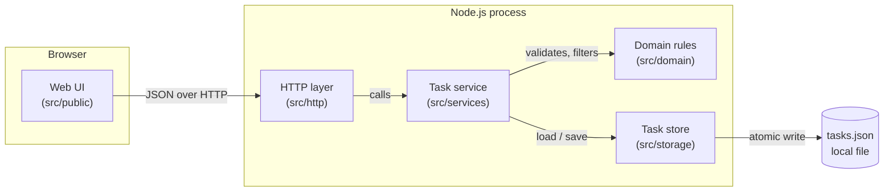
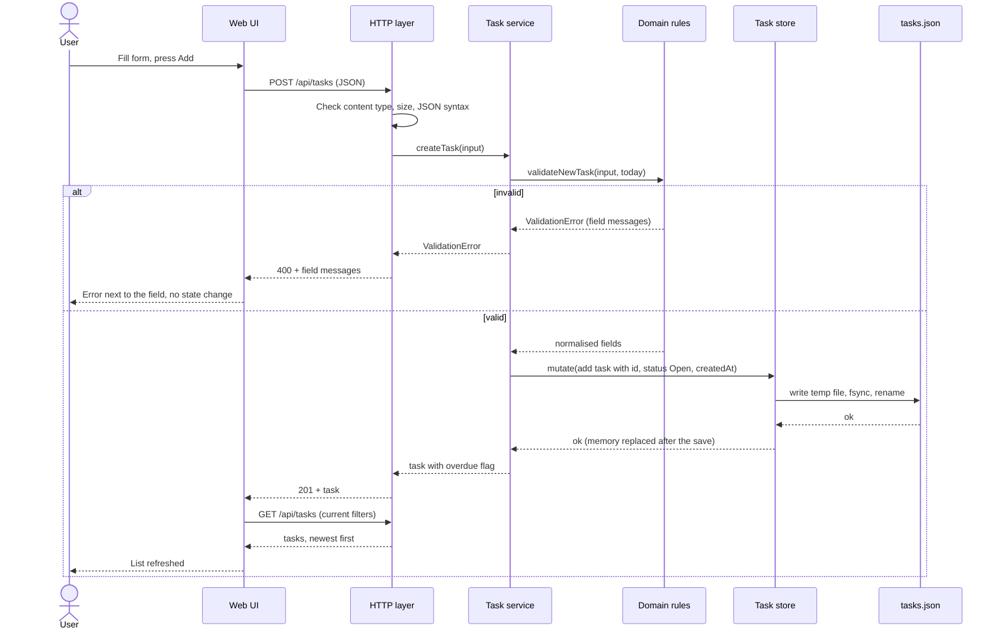

# Architecture - To Do Application

Status: Draft v0.2 (revised after design review), awaiting user approval
Date: 2026-11-05
Scope: US-001, US-002, US-003, US-004, US-005
Input: `docs/sdlc/requirements.md` (final; FR-1..FR-34, NFR-1..NFR-12, A-1..A-13) and `docs/sdlc/design-review.md` (findings DR-1..DR-17, decisions AD-1..AD-16)

## 1. Context

### 1.1 Goals

- Deliver all five stories (create, view and filter, edit, complete or reopen, delete) as one small application.
- Keep the design as simple as the requirements allow: one process, no database server, no runtime dependencies.
- Enforce validation in the business layer, not only in the UI (FR-34).
- Make every FR and NFR testable with `node:test`.

### 1.2 Constraints from requirements

- Single user, single device, no login (A-1).
- Node.js 20 or later; the repository is an ES-module project (`"type": "module"`) (A-2).
- Up to 1,000 tasks, no pagination (A-8).
- Local storage only; data survives restarts (FR-33, NFR-10).
- Date-only due dates in the user's local time zone (A-3).

### 1.3 Delivery form (resolves A-2)

A local web application. A Node.js process serves a browser UI and a small JSON API on `127.0.0.1`. The user opens `http://127.0.0.1:3000` in a browser.

Why a web UI: the requirements need inline validation errors next to fields (FR-2, NFR-6), visual highlights with non-colour cues (FR-16, FR-25, NFR-8), a confirmation prompt (FR-29), and keyboard operation with visible focus (NFR-7). A browser provides these with plain HTML.

Supported browsers: the latest two stable versions of Chrome, Edge, Firefox and Safari. Supported OS: any OS that runs Node.js 20 or later (see OQ-1).

## 2. Component diagram



### 2.1 Responsibilities

| Component | Path | Responsibility | Main requirements |
|-----------|------|----------------|-------------------|
| Web UI | `src/public/` | Render form, list, filters, empty state, confirmation dialog and messages. Call the API. Show field errors next to fields. Escape all text by using `textContent`. Format the completion timestamp in local time. Use the `overdue` flag from the API and never compute "today" in the browser. The form uses `novalidate` and the date input has no `min`, so an unchanged past date can be saved (A-6). | FR-2, FR-9, FR-15..FR-17, FR-24, FR-25, FR-29, FR-31, FR-22, NFR-1, NFR-6..NFR-8 |
| View model | `src/public/view-model.js` | Pure functions that turn a task into display data (labels, icon, overdue or completed cue, formatted dates). No DOM access, so it is unit-testable. | FR-16, FR-24, FR-25, NFR-8 |
| HTTP layer | `src/http/` | Route requests, read JSON with a streaming size limit, check `Host`, `Origin` and content type, map errors to status codes (including unknown route and method), serve the static UI files from an allow-list. Contains no business rules. | NFR-2, NFR-3, NFR-6 |
| Task service | `src/services/task-service.js` | Use cases: create, list, update, set status, delete. Orchestrates domain rules and the store. Every write runs inside `store.mutate`, so lookup, validation and change are one atomic step. Adds the derived `overdue` flag to every task it returns. Raises typed errors. | FR-1..FR-34 |
| Domain rules | `src/domain/` | Pure functions: input validation and normalisation, task factory, filter predicates, overdue test, date helpers, error types. The clock is injected. | FR-1..FR-6, FR-10..FR-14, FR-19, FR-24, FR-26, FR-34, NFR-2, NFR-11 |
| Task store | `src/storage/task-store.js` | Load tasks from a JSON file and check them (4.2), keep them in memory, report a corrupt or unreadable file, retry the load while the store is corrupt. Provides `mutate(fn)`: runs `fn(currentTasks)` in a one-at-a-time queue, saves the result with an atomic write (6.2), then replaces the in-memory list. This is the only way to change tasks. | FR-33, FR-27, FR-30, NFR-9, NFR-10 |
| Config | `src/config.js` | Read `PORT` and `TODO_DATA_FILE` from environment variables, with defaults. The default data file is resolved from the project root (from `import.meta.url`), not from the working directory. Reads no `.env` file. | NFR-3 |
| Entry point | `src/server.js` | Wire config, clock, store, service and HTTP layer; start the listener on `127.0.0.1`. On a listen error (for example port in use) print one line and exit with code 1. | all |

Dependency rule: UI -> HTTP -> service -> domain and store. The domain imports nothing from the other layers. The store knows nothing about validation.

## 3. Technology choices

| Area | Choice | Rationale | Rejected alternative |
|------|--------|-----------|----------------------|
| Runtime | Node.js 20+ | Already required by `package.json`; no extra install. | Python: second toolchain in a Node repository. |
| HTTP server | Built-in `node:http` | Five operations do not justify a framework; no dependencies to patch (NFR-3). | Express: adds a dependency tree for a handful of routes. |
| UI | Plain HTML, CSS and ES modules, no build step | Small UI; native `<dialog>`, `<form>` and `<label>` give keyboard and accessibility support (NFR-7). | React with a bundler: build chain and dependencies are not justified for one screen. |
| Storage | One JSON file written atomically (temp file then rename) | 1,000 tasks is about 200 KB; whole-file rewrite is well within NFR-4. Human-readable. | SQLite: native module or extra dependency for a tiny data set. |
| Task id | `crypto.randomUUID()` | Unique without a counter file (FR-8). | Auto-increment integer: needs persisted counter and is reused-risk after delete. |
| Tests | Built-in `node:test` and `node:assert` | Already used by `npm run test:scripts`; no dependency (NFR-12). | Jest: extra dependency and ESM configuration. |
| Delivery form | Local web app | See 1.3. | CLI: cannot show inline field errors or visual highlights as required by FR-2 and FR-16. |
| Confirmation prompt | In-page `<dialog>` element | Keyboard accessible, focus trapped, testable. | `window.confirm`: not stylable, not reliably testable. |

No runtime dependencies are added. `package.json` gets one script, `"test": "node --test \"tests/**/*.test.js\""`, during implementation.

## 4. Data model and storage

### 4.1 Task

| Field | Type | Rules | Source |
|-------|------|-------|--------|
| `id` | string (UUID v4) | Generated by the service. Never changes. | FR-8 |
| `title` | string | Trimmed. 1 to 100 Unicode code points after trimming (OQ-5). | FR-1, A-4 |
| `description` | string | 0 to 500 Unicode code points. Not trimmed. Default empty string. | FR-3 |
| `priority` | `"Low"` \| `"Medium"` \| `"High"` | Default `"Medium"`. | FR-4 |
| `dueDate` | string \| `null` | `YYYY-MM-DD`, a real calendar date, or `null`. Not before today when new or changed. | FR-5, FR-6, A-3, A-6 |
| `status` | `"Open"` \| `"Completed"` | Set to `"Open"` on create. Changed only by the status operation. | FR-7, FR-23, A-5 |
| `createdAt` | string (ISO 8601 UTC) | Set on create. Never changes. | FR-8 |
| `completedAt` | string (ISO 8601 UTC) \| `null` | Set when status becomes Completed. Cleared on reopen. | FR-24, FR-26 |

Derived value (not stored): `overdue = status === "Open" && dueDate !== null && dueDate < today`. It is computed at read time so it stays correct after midnight (NFR-11). The service adds it as a boolean `overdue` to every task the API returns (create, get, edit, status, list). The browser uses this flag and never compares dates itself.

### 4.2 File format

File path: `TODO_DATA_FILE`, default `<project root>/data/tasks.json`. The default does not depend on the working directory (OQ-2).

```json
{
  "version": 1,
  "tasks": [
    {
      "id": "3f6c2d1e-0c5e-4a52-9d57-5b9a1d3c7e10",
      "title": "Buy milk",
      "description": "",
      "priority": "Medium",
      "dueDate": "2026-11-06",
      "status": "Open",
      "createdAt": "2026-11-05T11:59:00.000Z",
      "completedAt": null
    }
  ]
}
```

- `tasks` is kept in creation order (oldest first). The list operation returns it reversed, so newest created is first, with or without filters (FR-10, A-11). Position depends only on insertion order, so there are no timestamp ties and edits never move a task.
- A missing file is a first run (OQ-6). At start the store creates the directory (recursive) and writes an empty store `{ "version": 1, "tasks": [] }`, and the server prints one console line with the full path. The UI shows no banner.
- Load check. The store is corrupt if any of these fails: the root is an object with `version` equal to 1 and an array `tasks`; every task has exactly the keys in 4.1; every task passes the field rules of 6.1 (without the past-date rule); ids are unique; `completedAt` is `null` exactly when status is `Open`; `createdAt` and `completedAt` are valid ISO 8601 strings. Invalid JSON is also corrupt. An unreadable file (for example a permission error) is reported as a separate message with the same code (see section 6).
- At start, a stale `*.tmp` file next to the data file is deleted.

### 4.3 Definition of "today" (NFR-11, A-3)

One function, `todayLocal(clock)` in `src/domain/dates.js`, returns the local calendar date as `YYYY-MM-DD` from the injected clock. Every past-date check and overdue test uses it. Because the application is single device (A-1), the server and the browser share one time zone. The UI shows the completion timestamp with `toLocaleString()` in the browser's time zone (FR-24, A-13). The browser never computes "today"; it uses the `overdue` flag from the API.

## 5. Data flow

### 5.1 API surface

| Method and path | Use case | Success | Errors |
|-----------------|----------|---------|--------|
| `POST /api/tasks` | Create (US-001) | 201 + task | 400 validation |
| `GET /api/tasks?status=&priority=&overdue=` | List and filter (US-002) | 200 + `{ tasks, total }` | 400 invalid filter value |
| `GET /api/tasks/:id` | Load a task for edit (FR-21) | 200 + task | 404 |
| `PUT /api/tasks/:id` | Replace title, description, priority, dueDate (US-003) | 200 + task | 400, 404 |
| `PUT /api/tasks/:id/status` with `{ "status": "Open" \| "Completed" }` | Complete or reopen (US-004) | 200 + task | 400, 404 |
| `DELETE /api/tasks/:id` | Delete (US-005) | 204 | 404 |

Notes:

- The UI toggle sends the opposite of the status it shows. An explicit target status is idempotent. Setting the status a task already has changes nothing and keeps the existing `completedAt`.
- `status=Open|Completed`, `priority=Low|Medium|High`, `overdue=true`. Filters combine with AND (FR-14). No filter returns all tasks. `total` is the unfiltered count, so the UI can choose between "No tasks yet" and "No tasks match your filters" (FR-17).
- `PUT /api/tasks/:id` rejects unknown keys such as `status`, `id` or `createdAt` with a validation error (NFR-2, A-5).
- `PUT /api/tasks/:id` replaces all four editable fields. `title`, `description`, `priority` and `dueDate` (string or `null`) are all required; a missing key is a validation error. Create defaults (priority Medium, description empty, no due date) apply only to `POST`.
- Every task in a response has the stored fields from 4.1 plus the boolean `overdue` (4.1). `GET /api/tasks` returns `{ tasks, total }` with `overdue` on each task.
- Query rules: an empty value (`?status=`) means the filter is not set. `overdue` accepts only `true`; the UI leaves it out when the filter is off. A repeated key, an unknown key or any other value returns 400 `VALIDATION_ERROR`.

### 5.2 Main use case: create a task and see it at the top (US-001)



The other use cases follow the same path. Edit, status change and delete do the lookup, the validation and the change inside one `store.mutate` call. If the task is missing, the function raises `NotFoundError` ("Task not found") and nothing is written. Because the queue runs one `mutate` at a time, a delete and an edit of the same task cannot both pass the lookup, and two quick changes cannot overwrite each other.

### 5.3 Edit rule for due dates (A-6)

`validateTaskUpdate(input, existingTask, today)` rejects a past `dueDate` only when it differs from `existingTask.dueDate`. An unchanged past date passes.

## 6. Error handling, security and validation

### 6.1 Validation (FR-34, NFR-2)

All rules live in `src/domain/validation.js` and run in the service, so the API and any future caller get the same result. The UI repeats only the length limits (`maxlength`) as a convenience.

| Rule | Check | Message (field) |
|------|-------|-----------------|
| Type | Body is an object; `title`, `description` are strings; `dueDate` is a string or `null`; `priority` is a string | "Enter a valid value." (field) |
| Title | After trim, 1..100 Unicode code points (`Array.from(s).length`) | "Enter a title." / "Title must be 100 characters or fewer." (`title`) |
| Description | 0..500 Unicode code points; not trimmed | "Description must be 500 characters or fewer." (`description`) |
| Priority | One of Low, Medium, High; default Medium on create | "Choose Low, Medium or High." (`priority`) |
| Due date format | Matches `YYYY-MM-DD` and is a real date (for example 2026-02-30 is rejected) | "Enter a valid date." (`dueDate`) |
| Due date past | Before `todayLocal` and (new task or changed value) | "Due date cannot be in the past." (`dueDate`) |
| Unknown keys | Any key outside the allowed set for the operation | "Unknown field." (that field) |
| Required keys on edit | `title`, `description`, `priority` and `dueDate` must all be present in `PUT /api/tasks/:id` | "This field is required." (that field) |
| Empty date string | `dueDate` is `null` or a valid date string; `""` is rejected (the UI sends `null` when the date is cleared) | "Enter a valid date." (`dueDate`) |
| Status | One of Open, Completed | "Choose Open or Completed." (`status`) |
| Filters | `status`, `priority`, `overdue` values from the allowed sets | "Invalid filter value." |

Validation collects all field errors in one pass and returns them together. Nothing is written when any rule fails (NFR-9).

### 6.2 Error model

Every error response has the shape `{ "error": { "code": "...", "message": "...", "fields": { "title": "..." } } }`; `fields` is present only for validation errors.

| Code | HTTP | When | UI behaviour |
|------|------|------|--------------|
| `VALIDATION_ERROR` | 400 | Rules in 6.1 fail, or JSON body is malformed | Show messages next to the fields (NFR-6); keep form values |
| `NOT_FOUND` | 404 | Unknown task id on get, edit, status, delete (FR-21, FR-28, FR-32) | Show "Task not found", close edit or dialog, refresh list |
| `ROUTE_NOT_FOUND` | 404 | Unknown URL path | Show generic failure message (never "Task not found") |
| `METHOD_NOT_ALLOWED` | 405 | Known path, unsupported method; the response has an `Allow` header | Show generic failure message |
| `FORBIDDEN` | 403 | `Host` or `Origin` header check fails (6.3) | Show generic failure message |
| `PAYLOAD_TOO_LARGE` | 413 | Body over 16 KB, counted while reading | Show generic failure message |
| `UNSUPPORTED_MEDIA_TYPE` | 415 | Content type is not `application/json` on write requests | Show generic failure message |
| `STORE_CORRUPT` | 500 | Data file is invalid JSON, wrong version, or fails the load check in 4.2; or the file cannot be read (permission error) | Banner: "Your task file cannot be read: <path>. It was not changed. Fix, move or delete the file, then reload this page." For a permission error the first sentence says the file cannot be opened. The file is never overwritten while corrupt |
| `STORE_WRITE_FAILED` | 500 | Temp write, `fsync` or rename fails after the retries in the rules below | Banner: "Your change could not be saved. Nothing was changed. Try again." In-memory state is unchanged |
| `INTERNAL` | 500 | Any unexpected error | Generic message; no stack trace in the response |

Behaviour rules:

- Delete of a missing task returns 404, and the UI treats it as "refresh and show message", not as a failure (FR-32).
- The service passes a function to `store.mutate`. The function receives the current list, finds the task, validates, and returns the new list. The store saves the new list, and only after a successful save replaces the in-memory list. A failed save leaves memory and file unchanged (NFR-9).
- `mutate` calls are processed one at a time (a promise queue in the store). Lookup, validation, change and save of one request finish before the next request starts, so there are no lost updates and no stale "exists" checks.
- Atomic write: create the directory if missing, write a temp file in the same directory, `fsync` it, then rename it over the data file. If the rename fails with `EPERM`, `EBUSY` or `EACCES` (common on Windows when another program briefly holds the file), retry up to 3 attempts in total, waiting 20 ms and then 50 ms. After that, fail with `STORE_WRITE_FAILED` and delete the temp file.
- On a corrupt store the server still starts and answers with `STORE_CORRUPT`, so the user sees a clear message instead of a crash (NFR-10). While the store is corrupt, every request tries to load the file again, so a repaired file works without a restart.
- On a listen error (for example port in use) the entry point prints one line, such as "Port 3000 is already in use. Set PORT to another value.", and exits with code 1.
- Errors are logged to the console as code and message only. Task content, file contents and environment values are not logged (NFR-3).

### 6.3 Security

| Concern | Approach | Requirement |
|---------|----------|-------------|
| Script injection | The UI writes user text with `textContent` and never uses `innerHTML` for task data. The server sends `Content-Security-Policy: default-src 'self'; script-src 'self'; style-src 'self'; object-src 'none'; base-uri 'none'; frame-ancestors 'none'`, plus `X-Content-Type-Options: nosniff`. Because of this policy, the UI uses no inline `style` attribute, no inline script and no inline event handler. | NFR-1 |
| Malformed input | Validation in 6.1; body limit 16 KB, counted while the body is read (not from `Content-Length` alone); JSON only. | NFR-2 |
| Network exposure | The listener binds to `127.0.0.1` only. | A-1 |
| Cross-site requests from other web pages | Write requests must have `Content-Type: application/json`, which forces a CORS preflight; the server sends no CORS headers, so other origins are blocked. The server also rejects requests whose `Host` header is not `127.0.0.1:<port>` or `localhost:<port>` (DNS rebinding). If an `Origin` header is present on a write request, it must equal `http://127.0.0.1:<port>` or `http://localhost:<port>`. A failed Host or Origin check returns 403 `FORBIDDEN`. | NFR-2 |
| Caching and referrer | API responses send `Cache-Control: no-store`. All responses send `Referrer-Policy: no-referrer`. | NFR-3 |
| Static file access | Only the files in an allow-list under `src/public/` are served; no path from the URL is joined to a directory. | NFR-3 |
| Secrets | The application has none. It reads `PORT` and `TODO_DATA_FILE` from the process environment and never reads `.env` files. | NFR-3 |
| Dependencies | No runtime dependencies. | NFR-3 |

### 6.4 Accessibility and usability

- Form controls have visible `<label>` elements. The form has `novalidate` and the date input has no `min` attribute, because an unchanged past due date must be savable (A-6); the server is the only authority for validation rules. Error text is linked with `aria-describedby` and announced with `role="alert"`. The first invalid field receives focus (NFR-6, NFR-7).
- Every action is a native `<button>`, `<input>` or `<select>`, reachable by Tab. The delete dialog uses `<dialog>` with `showModal()`, which traps focus, and returns focus to the trigger on close. A visible `:focus-visible` outline is defined (NFR-7).
- Overdue tasks show the text badge "Overdue" and a warning icon. Completed tasks show the text "Completed", a check icon and struck-through title. Colour is added on top of these cues. All text colours have a contrast ratio of at least 4.5:1 (FR-16, FR-25, NFR-8).
- Status messages use an `aria-live="polite"` region.

### 6.5 Performance (NFR-4, NFR-5)

- The store keeps all tasks in memory. Reads do not touch the disk. Filtering 1,000 tasks is a single array pass.
- Each write rewrites the whole file (about 200 KB at 1,000 tasks) once.
- The UI renders the full list without pagination, using one document fragment per refresh.
- A performance test seeds 1,000 tasks, calls the HTTP API on loopback, repeats each operation 20 times and asserts that the 95th percentile is within NFR-4 (200 ms) and NFR-5 (300 ms). The render time of 1,000 rows in the browser is checked in the manual checklist (see 8).

## 7. Directory layout

```
src/
  server.js                    entry point; wiring and listen
  config.js                    PORT, TODO_DATA_FILE
  domain/
    errors.js                  ValidationError, NotFoundError, StoreError
    dates.js                   todayLocal, isValidCalendarDate, isBefore
    validation.js              validateNewTask, validateTaskUpdate, validateStatus, validateFilters
    task.js                    createTaskRecord, applyUpdate, applyStatus, isOverdue
    filters.js                 filterTasks (AND logic), newest-first ordering
  services/
    task-service.js            createTask, listTasks, getTask, updateTask, setStatus, deleteTask
  storage/
    task-store.js              load and load check, mutate (one-at-a-time queue, atomic write with retry), corrupt-file detection
  http/
    app.js                     request handler, routing, header checks
    json-body.js               size limit, content type, JSON parse
    error-mapper.js            domain errors -> status and error body
    static-files.js            allow-listed static file serving and security headers
  public/
    index.html
    styles.css
    app.js                     UI wiring and event handlers
    api-client.js              fetch wrapper that returns data or a structured error
    view-model.js              pure display helpers
tests/
  unit/
    dates.test.js
    validation.test.js
    task.test.js
    filters.test.js
    task-service.test.js       uses an in-memory fake store and fixed clock
    task-store.test.js         uses a temporary directory
    view-model.test.js
    error-mapper.test.js
  integration/
    api-create.test.js
    api-list-filter.test.js
    api-edit.test.js
    api-status.test.js
    api-delete.test.js
    api-security.test.js       headers, content type, body limit, host check, static allow-list
    persistence.test.js        restart keeps data; corrupt file; failed write leaves data unchanged; missing file is first run
    concurrency.test.js        parallel requests: no lost update; delete racing edit gives one success and one 404
    performance.test.js        1,000 tasks against NFR-4 and NFR-5
```

Runtime data: `<project root>/data/tasks.json` (directory and file created at start). `data/` is added to `.gitignore` during implementation (see OQ-2).

## 8. Testing approach (NFR-12)

- Framework: `node:test` with `node:assert/strict`. Command: `npm test` (script added during implementation).
- Clock: services take an injected clock, so past-date, overdue and midnight cases use fixed dates without waiting.
- Unit tests cover the happy path, validation failures and Not Found for every use case (coding standards).
- Boundary tests: title 0, 1, 100 and 101 characters; description 500 and 501 characters; whitespace-only title; due date yesterday, today and tomorrow; 2026-02-30; a title of 100 emoji (accepted) and 101 emoji (rejected), because length is counted in code points.
- Concurrency tests: fire parallel creates, parallel edits of different tasks and a delete racing an edit of the same task; assert no change is lost and the file stays valid.
- Store tests with a fake file system layer: rename fails twice with `EPERM` then succeeds (retry works); rename fails every time (`STORE_WRITE_FAILED`, data unchanged); load check rejects duplicate ids, an Open task with `completedAt` and a Completed task without it.
- HTTP tests: a chunked body over 16 KB returns 413; a foreign `Origin` returns 403; unknown route returns 404 `ROUTE_NOT_FOUND`; unsupported method returns 405; query rules from 5.1.
- Integration tests start the real HTTP server on port 0 with a temporary data file and call it with `fetch`.
- Persistence tests create a task, start a new server on the same file and read it back (FR-27, FR-33); they also test a corrupt file and a forced write failure.
- UI behaviour that needs a browser (focus order, dialog focus return, contrast, keyboard-only use, saving an edit that keeps a past due date, render time of 1,000 rows within 300 ms) is checked by a manual checklist in the verification step. The logic behind the UI is covered by `view-model.test.js` and the API tests. No browser automation tool is added (see R-5).

## 9. Traceability

### 9.1 Functional requirements

| FR | Components | Tests |
|----|------------|-------|
| FR-1, FR-2 | validation.js, task-service, UI form | validation.test.js, api-create.test.js |
| FR-3, FR-4, FR-5 | validation.js, task.js | validation.test.js, task.test.js |
| FR-6 | validation.js, dates.js | validation.test.js, dates.test.js |
| FR-7, FR-8 | task.js, task-service | task.test.js, api-create.test.js |
| FR-9, FR-10 | task-service, filters.js, UI list | filters.test.js, api-list-filter.test.js |
| FR-11, FR-12, FR-13, FR-14 | filters.js, task.js (`isOverdue`) | filters.test.js, api-list-filter.test.js |
| FR-15, FR-17 | UI filter bar, empty state; `total` in list response | view-model.test.js, api-list-filter.test.js, manual checklist |
| FR-16, FR-25 | view-model.js, styles.css | view-model.test.js, manual checklist |
| FR-18, FR-19, FR-20 | validation.js, task.js (`applyUpdate`), task-service | task.test.js, api-edit.test.js |
| FR-21, FR-28, FR-32 | NotFoundError, error-mapper.js, UI message | task-service.test.js, api-edit.test.js, api-status.test.js, api-delete.test.js |
| FR-22, FR-31 | UI only (no request is sent) | manual checklist |
| FR-23, FR-24, FR-26 | task.js (`applyStatus`), view-model.js | task.test.js, api-status.test.js, view-model.test.js |
| FR-27, FR-30, FR-33 | task-store.js | task-store.test.js, persistence.test.js, api-delete.test.js |
| FR-29 | UI `<dialog>` | manual checklist |
| FR-34 | validation.js called from the service | task-service.test.js (calls the service without the UI) |

### 9.2 Non-functional requirements

| NFR | Design element | Verified by |
|-----|----------------|-------------|
| NFR-1 | `textContent`, CSP headers | api-security.test.js (headers), manual check with `<script>` title |
| NFR-2 | validation.js, json-body.js, error-mapper.js | validation.test.js, api-security.test.js |
| NFR-3 | config.js, log policy, no dependencies | api-security.test.js, code review |
| NFR-4, NFR-5 | In-memory store, single-pass filter | performance.test.js |
| NFR-6 | Field-level `fields` map, UI error placement | validation.test.js, manual checklist |
| NFR-7, NFR-8 | Native controls, `<dialog>`, text and icon cues, contrast | view-model.test.js, manual checklist |
| NFR-9 | `store.mutate` (one-at-a-time read-modify-write), save-then-swap, atomic rename with retry | persistence.test.js, concurrency.test.js, task-store.test.js |
| NFR-10 | Corrupt-file detection with load check, retry of load, server keeps running, first-run handling | task-store.test.js, persistence.test.js |
| NFR-11 | `todayLocal` single definition, overdue computed on the server and sent as `overdue` | dates.test.js, filters.test.js, api-list-filter.test.js |
| NFR-12 | `node:test` suites in section 7 | verification step |

## 10. Risks

| ID | Risk | Impact | Mitigation |
|----|------|--------|------------|
| R-1 | The tab stays open past midnight, so the overdue state on screen is stale. | Medium | Overdue is computed on the server at every list call. The UI refreshes the list after every action and when the tab regains focus. A tab that stays visible and untouched across midnight stays stale until the next action or focus change (accepted, AR-1 in the design review). |
| R-2 | The server and browser use different time zones (for example the app is reached through a VPN or remote session). | Low | Out of scope by A-1; the server time zone defines "today". Recorded for the design review. |
| R-3 | Two browser tabs edit the same task (last write wins). | Low | Accepted for single user (A-1). `store.mutate` prevents lost updates between different tasks and file corruption. |
| R-4 | A power loss during a write. | Low | Temp file plus rename keeps the previous file intact. |
| R-5 | Browser-only requirements (focus, contrast, keyboard) have no automated test. | Medium | Manual checklist in `verification.md`. Browser automation can be added later if the user wants it. |
| R-6 | Another local program edits `data/tasks.json` by hand and breaks it. | Low | Shape check on load; corrupt file is reported and never overwritten. |
| R-7 | Whole-file rewrite becomes slow beyond the 1,000 task target. | Low | Covered by the performance test; storage sits behind the store interface and can be swapped. |
| R-8 | Two server instances (different ports) use the same data file and overwrite each other's changes. | Low | Accepted for single user (A-1). `store.mutate` protects one process only. The README tells the user to run one instance (design review AR-2). |
| R-9 | Another program holds the data file longer than the rename retries (about 70 ms), so a save fails. | Low | The change is rolled back, the user sees "Nothing was changed. Try again." (design review AR-5). |

## 11. Open questions

| ID | Question | Proposed assumption (used until answered) |
|----|----------|-------------------------------------------|
| OQ-1 | Which browsers must be supported? | Latest two stable versions of Chrome, Edge, Firefox and Safari. |
| OQ-2 | Where is the data file stored, and may `data/` be added to `.gitignore`? (Revised in v0.2: the default no longer depends on the working directory.) | `<project root>/data/tasks.json`, overridable with `TODO_DATA_FILE`; `data/` is git-ignored so personal tasks are not committed. |
| OQ-3 | Is a fixed default port acceptable? | Port 3000, overridable with `PORT`. |
| OQ-4 | Is adding an `npm test` script to `package.json` acceptable? | Yes; it is the only `package.json` change. |
| OQ-5 | Are "characters" in FR-1 and FR-3 counted as Unicode code points, so that one emoji is one character? | Yes, code points. The UI sets no `maxlength`; the server error is shown next to the field. |
| OQ-6 | NFR-10 says a missing store is reported. Is a silent first-run start acceptable (file created, one console line with the path, no UI message)? | Yes. A missing file at start is treated as a first run. |

## 12. Revision history

| Version | Date | Change | Author |
|---------|------|--------|--------|
| 0.1 | 2026-11-05 | First draft covering US-001..US-005 | Solution architect agent |
| 0.2 | 2026-11-05 | Design review changes (see `design-review.md`, section 6): `store.mutate` for atomic read-modify-write (DR-1); `overdue` returned by the API (DR-2); no `min` and `novalidate` on the form (DR-3); `PUT` is full replacement (DR-4); first-run handling (DR-5); corrupt-store recovery (DR-6); safer atomic write with `fsync` and Windows rename retry (DR-7); text length in code points (DR-8); load-time invariants (DR-9); `Origin` check and cache headers (DR-10); new error codes (DR-11); query rules (DR-12); streaming body limit (DR-13); performance test method (DR-14); data path from project root (DR-15); listen error handling (DR-16). Added risks R-8, R-9 and open questions OQ-5, OQ-6; OQ-2 revised. | Design reviewer agent |
